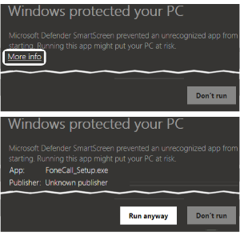

 Downloadable Options

|File|Description|
|----|----|
| FoneCall_Setup.zip|FoneCall installer executable[^1]|
| FoneCall_Setup+NDP481-Web.zip|FoneCall_Setup and NDP481-Web[^2] executables|
| FoneCall_Portable.zip|FoneCall [binaries](https://www.google.com/search?q=what+are+application+binaries) containing the FoneCall_Portable.exe and required supporting files.  ~Unzip retaining folder structure.|
| FoneCall_Portable+NDP481-Web.zip| FoneCall binaries zip file and NDP481-Web[^2] executable|

[^1]: Setup makes the Registry entries to add FoneCall to the Start Menu and  support application add/uninstall.  No other modifications to the Registry are made
[^2]: NDP481-Web is Microsoft's official .Net Framework 4.8 runtime installer 

### 🚀 Installation Guide
#### Why no "Setup.exe"
Browsers, email clients and antivirus scanners frequently block direct downloads of .exe installers or flag them with aggressive SmartScreen warnings. Packaging the installer inside a `.ZIP archive` ensures you can download it safely.

#### SmartScreen Considerations
FoneCall features a fully transparent development process with a public codebase repository. To keep the project free, it is distributed without an expensive commercial code-signing certificate. Because of this, Windows Defender SmartScreen will display a standard "Windows protected your PC" warning when you launch the installer. While this warning is a helpful security feature for truly unknown files, it is a false alarm here since the source is trusted.

*   ***The Root Cause:*** Windows SS makes no distinction between truly well known sources—such as GitHub—and other sources. 

    When you use the default Windows File Explorer to extract a ZIP file, it automatically propagates an internet tracking tag—called *Mark of the Web* (MotW)—to every single file inside the zip file. This often causes Windows Defender or SmartScreen to block the installer from launching or corrupts the extraction process.

*   ***The Solution:*** To avoid the unnecessary warnin use `7-Zip`,  `.WinRAR` or any other unzipping tool to extract the FoneCall installer. (`7-Zip` is preferred by the author.)

    Using third-party tools like 7-Zip or WinRAR safely typically extracts the files without forcefully tagging the installer with the MotW, allowing the setup to run smoothly.

> [!IMPORTANT]
> **TLDR:** Use `7-Zip`,  `.WinRAR` or other archiving utility to extract the FoneCall installer. ***Do not use*** Windows built-in unzip.

#### If you still see the Windows SmartSscreen warning, follow these steps to bypass it:

 
 
 *Note: Because our installer is configured for "User-Mode", it will install cleanly into your user directory without requiring an administrative password.*|

