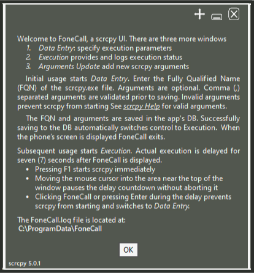
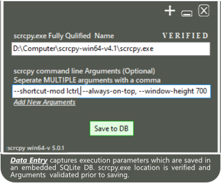
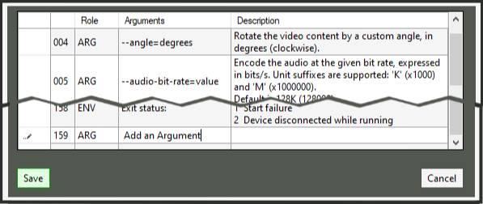

## FoneCall Walkthrough
The tool is minimalist with two small footprint core windows and to subsidiary windows. The windows are:
* *Welcome - subsidiary*
* Data Entry - Core
* Execution - Core
* *Options Reference and Argument Update - subsidiary*

### Welcome Window
Welcome describes tool usage. It is only shown the first time FoneCall is launched after installation. The text is included in the log for future reference.  

### Data Entry Window
Data Entry captures execution parameters which are saved in an embedded SQLite database (DB). The `scrcpy.exe` file location is verified and `Arguments` are validated prior to saving.  

### scrcpy Execution Window
Execution starts scrcpy and displays & logs execution status. In the initial launch of FoneCall after installation Execution is triggered by successfully saving the execution parameters to the DB. In subsequent launches Execution is the initial window if valid execution parameters are in the DB.  If the parameters are missing or invalid, the user is returned to the *`Data Entry`* window to correct the issue.

There is a seven second delay between the launch of FoneCall and the start of scrcpy. During the delay, the user can:
*   start  scrcpy immediately
*   pause the countdown
*   cancel the execution and switch to *`Data Entry`*

When the phone is displayed on the computer screen FoneCall exits.  If an error occurs, the user is returned to the *`Data Entry`* window to correct the issue.  

### scrcpy Options Reference and Argument Update Window
Options Reference and Update displays scrcpy Help and provides the opportunity to add new scrcpy Options when they are introduced. This is the source for the Arguments validation in *`Data Entry`*.  

Return to the FoneCall [README](README.md) for more information on the tool, its features, and installation instructions.
