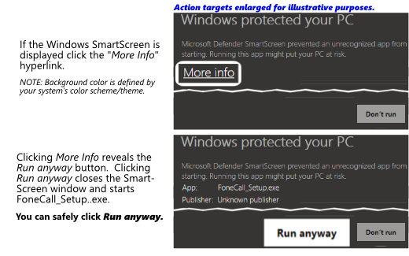

<p align="center">
  <a href="./README.md">Overview</a> •
  <strong>Installation Guide</strong> •
  <a href="./FoneCallWalkthru.md">App Walkthrough</a> •
  <a href="https://github.com/LifesRain/FoneCall/releases/latest">Latest Releases</a>
</p>

---
## Installation Guide & Caveats
FoneCall can be installed on your system using the standard Windows installer or run directly from a folder as a portable app.

#### **Download Package Considerations**

<details>
<summary>Click here for installer and portable comparison</summary>
<br>

|Feature|Standard Installer (Setup)|Portable Version (Folder)|
|----|----|----|
|Best For|Everyday users who want a traditional Windows app experience.|Users who want to run from USB drives, or keeping the system registry untouched.|
|Start Menu & Uninstall|Adds Start Menu shortcuts and registers in Windows Apps & features.|None. Run directly from the extracted folder; delete the folder to remove.|
|Windows Registry|Saves the scrcpy path under HKCU\SOFTWARE\FoneCall.|No Registry modifications. Settings are stored locally in the app folder.|
|scrcpy Setup|Includes a built-in "Get scrcpy" option during setup.|Requires manual placement or linking of scrcpy if not already on your system.|

</details>

#### **Download Packages**
Browsers, email clients and antivirus scanners frequently block direct downloads of .exe installers or flag them with aggressive SmartScreen warnings. All releases are packaged in a `.ZIP archive` to avoid direct .exe download blocking.

| Download File Name | .zip File Contents |
| :--- | :--- |
| [1-FoneCall_Setup.zip](https://github.com/LifesRain/FoneCall/releases/latest/download/1-FoneCall_Setup.zip) | `FoneCall_Setup` — the installer executable[^1] which includes a "get scrcpy" option. |
| [2-FoneCall_Setup_and_NDP481-Web.zip](https://github.com/LifesRain/FoneCall/releases/latest/download/2-FoneCall_Setup_and_NDP481-Web.zip) | `FoneCall_Setup` and `NDP481-Web`[^2] executables. |
| [3-FoneCall_Portable.zip](https://github.com/LifesRain/FoneCall/releases/latest/download/3-FoneCall_Portable.zip) | FoneCall binaries containing `FoneCall_Portable.exe` and the required supporting files. Unzip while retaining the folder structure. |
| [4-FoneCall_Portable_and_NDP481-Web.zip](https://github.com/LifesRain/FoneCall/releases/latest/download/4-FoneCall_Portable_and_NDP481-Web.zip) | FoneCall binaries and the `NDP481-Web`[^2] executable. |

[^1]: Setup creates the Registry entries required to<br/>
(1) add FoneCall to the Start Menu and register it with Windows Apps & features for easy uninstallation<br/>
(2) save scrcpy location via Computer\HKEY_CURRENT_USER\SOFTWARE\FoneCall<br/>
No other modifications to the Registry are made.  
[^2]: NDP481-Web is Microsoft's official .Net Framework 4.8 runtime installer 

#### Before You Extract: Avoiding SmartScreen Warnings

> [!IMPORTANT]
> ***Do not use*** Windows built-in unzip. Use **`7-Zip`,  `.WinRAR`** or equivalent to extract the FoneCall installer. 

*   ***What triggers SmartScreen:***  FoneCall is source-available and free, so it is distributed without a commercial code-signing certificate. When you unzip files using Windows' built-in extractor, Windows attaches a Mark of the Web (MotW) tracking tag to every file inside. Because of this, Windows Defender SmartScreen displays a false-positive "Windows protected your PC" warning when you launch the installer or (for the Portable version) launch FoneCall.exe. 

  * ***Why a third party tool helps:*** Third-party tools like 7-Zip or WinRAR extract the files without forcefully tagging the installer with the MotW, allowing the setup to run smoothly.

#### **If you still see the Windows SmartScreen warning**

<details>
<summary><strong>Click here for SmartScreen navigation instructions</summary>
<br>



</details>


### Setup Instructions

Pre-Installation Requirements for First Time scrcpy Users


<details>
<summary>Click here for Android preparation and connection</summary>
<br>

<details>
<summary>Click here if you need scrcpy</summary>
<br>

If downloading **FoneCall_Setup** use the scrcpy Configuration page:
1. Click the Download scrcpy...** button on the installer page to visit the scrcpy Releaes page and download the appropriate scrcpy package (scroll down to Assets)<br/>
2. After exxtraction (see below) paste the scrcpy.exe path in the provided space or browse to `scrcpy.exe`.

If downloading **FoneCall_Portable** get the appropriate scrcpy package from the [official scrcpy project](https://github.com/Genymobile/scrcpy/releases).1

Extract the `.zip` archive to a permanent folder and save the scrcpy path<br/>
**Note:** If the scrcpy folder location changes after running FoneCall update the location in FoneCall's Data Entry window.


</details>

For scrcpy and FoneCall to communicate with your phone, **USB Debugging** must be enabled on your Android device:

1. **Enable Developer Options:**
   * Open **Settings** > **About phone** (on some devices, **Settings** > **About phone** > **Software information**).
   * Locate **Build number** and tap it **7 times** until you see a *"You are now a developer!"* message. *(You may be prompted to enter your device PIN).*
2. **Enable USB Debugging:**
   * Go back to **Settings** > **System** > **Developer options** (or search for **Developer options** in Settings).
   * Scroll down and toggle on **USB debugging**.
   * *(Optional — Xiaomi/POCO/Redmi users only):* Also enable **USB debugging (Security settings)** if you want to control the screen using your PC mouse and keyboard.
3. **Authorize Your PC:**
   * Connect your phone to your PC using a **data-capable USB cable** (charge-only cables will not work).
   * Unlock your phone screen. When the **"Allow USB debugging?"** prompt appears, check **Always allow from this computer** and tap **Allow**.

> **Using Wireless Connection?** Connect via USB first to complete the authorization above, or ensure **Wireless debugging** is enabled under Developer options before connecting over Wi-Fi.


</details>


Option A: Standard Installer (Setup)

1. Download 1-FoneCall_Setup.zip (or 2-FoneCall_Setup_and_NDP481-Web.zip).
2. Extract the archive using 7-Zip or WinRAR.
3. Double-click FoneCall_Setup.exe to launch the installation wizard.
4. Follow the on-screen prompts. Check the "Get scrcpy" option if you do not already have scrcpy installed on your PC.
5. Launch FoneCall from your Windows Start Menu.

Option B: Portable Version (Portable)

1. Download 3-FoneCall_Portable.zip (or 4-FoneCall_Portable_and_NDP481-Web.zip).
2. Extract the archive using 7-Zip or WinRAR. Make sure to preserve the folder structure so the supporting .dll and config files remain alongside the executable.
3. ***Move (cut & paste)*** the extracted FoneCall Portable folder to your preferred location (e.g., C:\Tools\FoneCall Portable or a USB drive).
4. Open the folder and double-click FoneCall_Portable.exe to run the app. (Do not move FoneCall_Portable.exe out of its folder without its supporting files.)

First-Run Firewall Prompt (scrcpy and ADB.exe)


#### **scrcpy and ADB.exe**

<details>
<summary>Click here for ADB.exe and Windows Firewall explanation</summary>
<br>

`scrcpy.exe` uses ADB (Android Debug Bridge) to communicate with your phone. If executing scrcpy via FoneCall is the first time scrcpy is run on your computer, Windows Firewall may ask permission to let `adb.exe` through the firewall. You can leave **Private networks** checked and click **Allow access**.

</details>


#### Download Integrity Verification
You can verify that your downloaded .zip archive matches the official GitHub release using **`PowerShell`**. Open PowerShell, navigate (cd) to your Downloads folder, and run one of the commands below.

For details on our security architecture, see our [Security Policy](SECURITY.md).

#### Automated "One-Liner" Script (Requires Internet)
*Automatically checks your local .zip file against the latest GitHub release SHA-256 digest:*
```powershell
$files=Get-ChildItem -File|Where-Object Name -in '1-FoneCall_Setup.zip','2-FoneCall_Setup_and_NDP481-Web.zip','3-FoneCall_Portable.zip','4-FoneCall_Portable_and_NDP481-Web.zip';if(-not $files){Write-Host 'ERROR: No FoneCall .zip package found in this folder.' -ForegroundColor Red}else{$release=Invoke-RestMethod -Uri 'https://api.github.com/repos/LifesRain/FoneCall/releases/latest' -Headers @{'User-Agent'='FoneCall-checksum'};Write-Host "Checking release $($release.tag_name)...";$assets=$release.assets;foreach($f in $files){$a=$assets|Where-Object name -eq $f.Name;if(-not $a){Write-Host "ERROR: Asset not found in release: $($f.Name)" -ForegroundColor Red}elseif([string]::IsNullOrWhiteSpace($a.digest)){Write-Host "ERROR: SHA-256 digest not found for $($f.Name)." -ForegroundColor Red}elseif((Get-FileHash -LiteralPath $f.FullName -Algorithm SHA256).Hash -ieq ($a.digest -replace '^sha256:','')){Write-Host "VERIFIED: $($f.Name) matches published GitHub release." -ForegroundColor Green}else{Write-Host "WARNING: Checksum mismatch for $($f.Name)!" -ForegroundColor Red}}}
```

##### Manual Command for Verification *Offline)*

*Generates the local SHA-256 hash so you can compare it against the sha256 badge under Assets on the GitHub Releases page:*
```powershell
Get-FileHash .\*FoneCall*.zip -Algorithm SHA256 | Select-Object @{Name="File";Expression={Split-Path $_.Path -Leaf}}, Hash
```
---

<p align="center">
  <a href="./README.md">Overview</a> •
  <strong>Installation Guide</strong> •
  <a href="./FoneCallWalkthru.md">App Walkthrough</a> •
  <a href="https://github.com/LifesRain/FoneCall/releases/latest">Latest Releases</a>
</p>